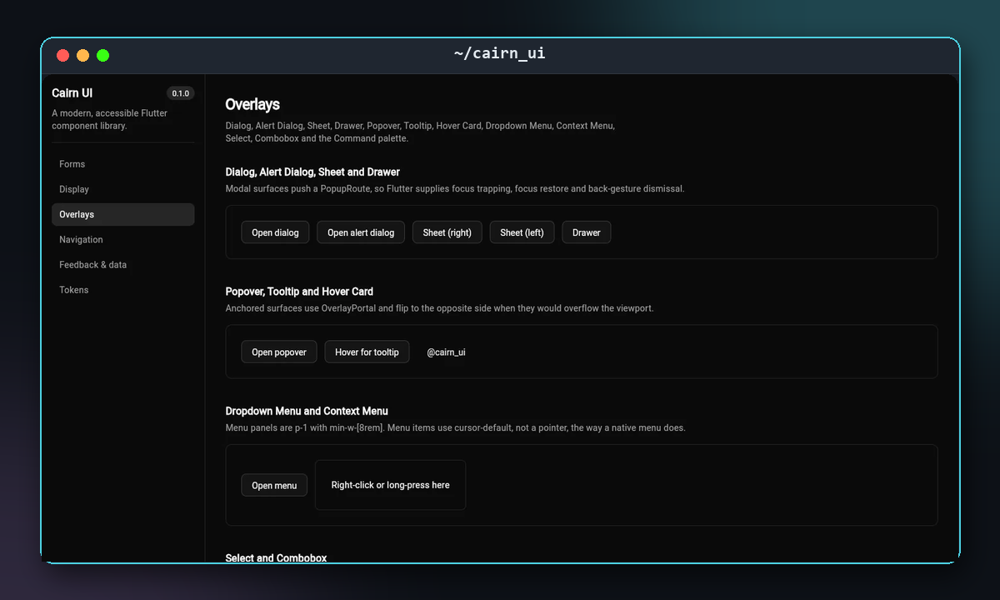
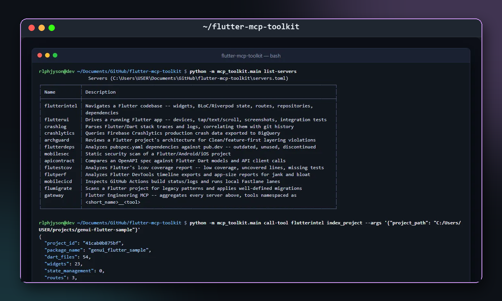
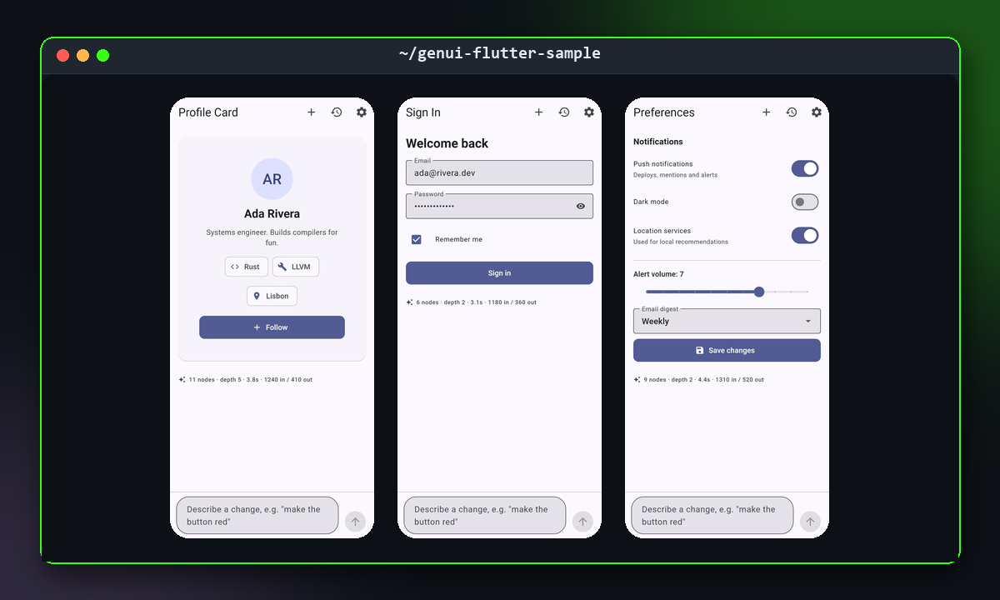
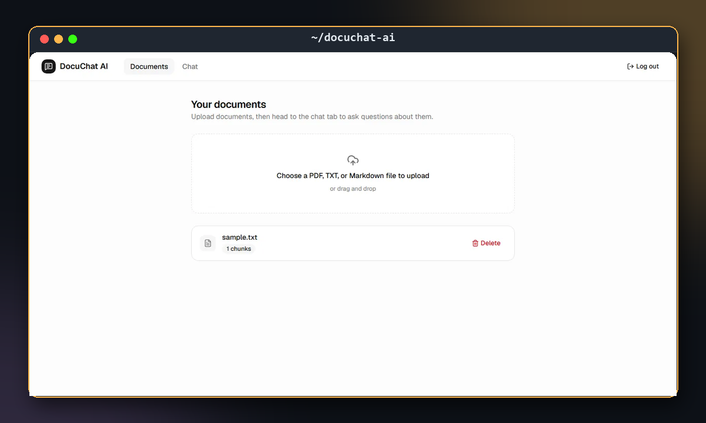
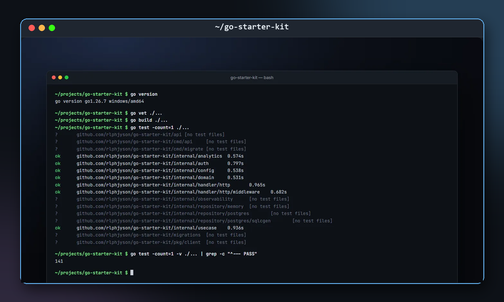
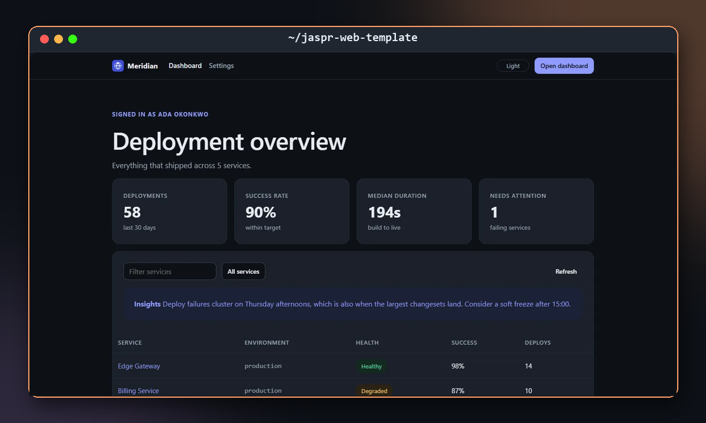
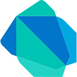
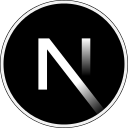

<a href="https://ralph-burgos.netlify.app/">
  <picture>
    <source media="(prefers-color-scheme: dark)" srcset="assets/header-dark.svg" />
    <source media="(prefers-color-scheme: light)" srcset="assets/header-light.svg" />
    
  </picture>
</a>

  
  
  
  

## Hi, I'm Ralph 👋

I'm a **Senior Software Engineer** from the Philippines with **5+ years** of shipping production apps for mobile and web.
**Flutter** is my daily driver. I care about the parts that keep a product healthy as it grows: clean architecture, reusable UI systems, real test coverage and releases that run themselves.

Lately I've been building **AI-native developer tools on Claude**: RAG apps, MCP servers, live agent dashboards and generative UI.

- 🧱 **Design systems.** I build component libraries with engineered tokens. [Cairn UI](https://github.com/rlphjyson/cairn_ui) is live on [pub.dev](https://pub.dev/packages/cairn_ui).
- 🤖 **AI tooling.** I write MCP servers, RAG pipelines, agent runners, and LLM output compiled into native widgets.
- 📱 **Flutter at scale.** I've run monorepos for multiple production apps, with GitHub Actions + Fastlane releases and golden tests.
- 🔐 **The boring-but-critical bits.** JWT with refresh rotation, OAuth2, RBAC, idempotency and offline-first sync.

> 💡 My portfolio is a terminal. Open [ralph-burgos.netlify.app](https://ralph-burgos.netlify.app/), then press <kbd>/</kbd> to search, <kbd>:</kbd> for commands, or <kbd>`</kbd> for a shell.

## ✨ Featured projects

<table>
  <tr>
    <td width="50%" valign="top">
      
      <h3><a href="https://github.com/rlphjyson/cairn_ui">Cairn UI</a></h3>
      A modern, accessible Flutter component library: <b>65 widgets</b> on an engineered token system with OKLCH colours, matched light and dark themes, and golden tests.
        
      <code>Flutter</code> <code>Dart</code> <code>Golden tests</code>
        
      <a href="https://pub.dev/packages/cairn_ui">📦 pub.dev</a> · <a href="https://rlphjyson.github.io/cairn_site/">🌐 Docs site</a>
    </td>
    <td width="50%" valign="top">
      
      <h3><a href="https://github.com/rlphjyson/flutter-mcp-toolkit">Flutter MCP Toolkit</a></h3>
      <b>Twelve MCP servers</b> for the Flutter lifecycle: code intelligence, UI testing, crash analysis, architecture review, mobile security, coverage, CI/CD and more. All of them sit behind one gateway.
        
      <code>Python</code> <code>MCP</code> <code>Flutter</code> <code>Claude</code>
    </td>
  </tr>
  <tr>
    <td width="50%" valign="top">
      
      <h3><a href="https://github.com/rlphjyson/genui-flutter-sample">GenUI Flutter</a></h3>
      Describe an interface in plain language. Claude returns a <b>structured UI spec</b> through tool use, and the app compiles it into <b>real native widgets at runtime</b>. No WebView, no rebuild.
        
      <code>Flutter</code> <code>Claude API</code> <code>Riverpod</code> <code>Firebase</code>
    </td>
    <td width="50%" valign="top">
      
      <h3><a href="https://github.com/rlphjyson/docuchat-ai">DocuChat AI</a></h3>
      Chat with your documents. A full-stack <b>RAG</b> app with local embeddings, a Chroma vector store and <b>streamed, cited answers</b> from Claude.
        
      <code>Next.js</code> <code>TypeScript</code> <code>FastAPI</code> <code>Chroma</code> <code>Claude</code>
    </td>
  </tr>
  <tr>
    <td width="50%" valign="top">
      
      <h3><a href="https://github.com/rlphjyson/go-starter-kit">Go Starter Kit</a></h3>
      A production-shaped Go API template. It has clean layering, <b>sqlc + pgx</b>, JWT with refresh rotation and reuse detection, feature flags, idempotency keys, and an OpenAPI spec with a typed client.
        
      <code>Go</code> <code>PostgreSQL</code> <code>Docker</code> <code>OpenAPI</code>
    </td>
    <td width="50%" valign="top">
      
      <h3><a href="https://github.com/rlphjyson/jaspr-web-template">Jaspr Web Template</a></h3>
      A server-rendered <b>Dart</b> web app. It uses an islands architecture, httpOnly-cookie auth, an offline service worker and proper SEO, with <b>224 tests</b> in CI.
        
      <code>Dart</code> <code>Jaspr</code> <code>SSR</code> <code>Clean Architecture</code>
    </td>
  </tr>
</table>

### More things I've built

| Project | What it is | Stack |
| --- | --- | --- |
| [Cairn Site](https://github.com/rlphjyson/cairn_site) | Cairn UI's docs site, built with Cairn UI itself ([live](https://rlphjyson.github.io/cairn_site/)) | Flutter web |
| [MCP Toolkit AI](https://github.com/rlphjyson/mcp-toolkit-ai) | 17 MCP servers, from semantic code search to safe SQL, behind one gateway | Python · MCP |
| [Agent Ops Dashboard](https://github.com/rlphjyson/agent-ops-dashboard) | Watch Claude agents work live: every tool call streamed, many runs at once | Next.js · FastAPI · WebSockets |
| [LocalChat AI](https://github.com/rlphjyson/localchat-ai) | A ChatGPT-like desktop app on a fully local model, with no data leaving the machine | Electron · Next.js · Ollama |
| [FastAPI Starter Kit](https://github.com/rlphjyson/fastapi-starter-kit) | A hexagonal FastAPI template with 227 tests and `mypy --strict` | Python · SQLAlchemy · PostgreSQL |

## 🛠️ Tech stack

  <b>Mobile &amp; frontend</b> 
  &nbsp;
  &nbsp;
  &nbsp;
  &nbsp;
  &nbsp;
  &nbsp;
  

  <b>Backend &amp; data</b> 
  &nbsp;
  &nbsp;
  &nbsp;
  &nbsp;
  &nbsp;
  &nbsp;
  &nbsp;
  &nbsp;
  

  <b>Cloud, DevOps &amp; AI</b> 
  &nbsp;
  &nbsp;
  &nbsp;
  &nbsp;
  &nbsp;
  &nbsp;
  

  <b>Tools</b> 
  &nbsp;
  &nbsp;
  

---

  <a href="mailto:rlphjyson@gmail.com">rlphjyson@gmail.com</a> · <a href="https://ralph-burgos.netlify.app/">ralph-burgos.netlify.app</a>

Icons: <a href="https://devicon.dev">Devicon</a> (MIT) and <a href="https://simpleicons.org">Simple Icons</a> (CC0).
